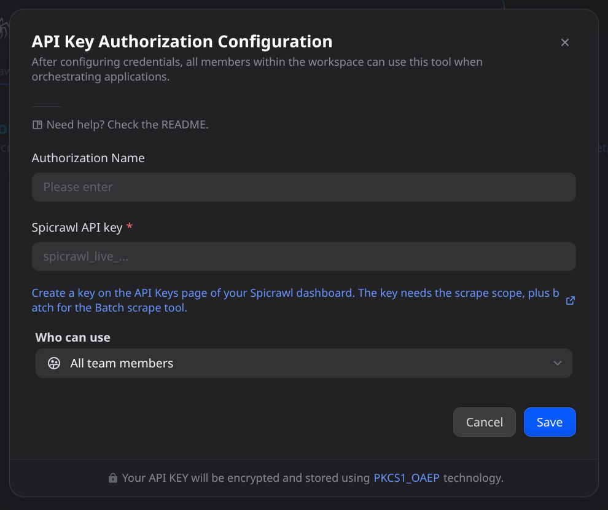
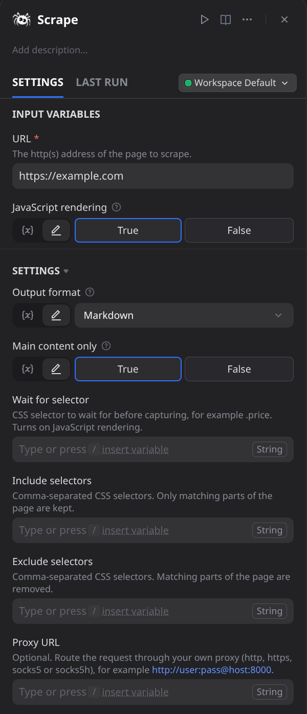
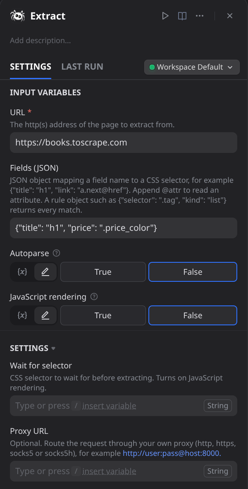
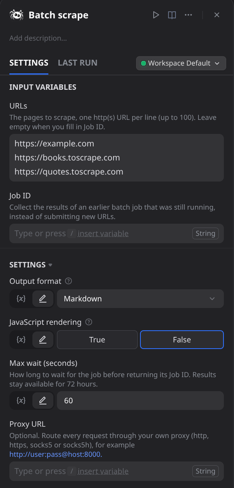
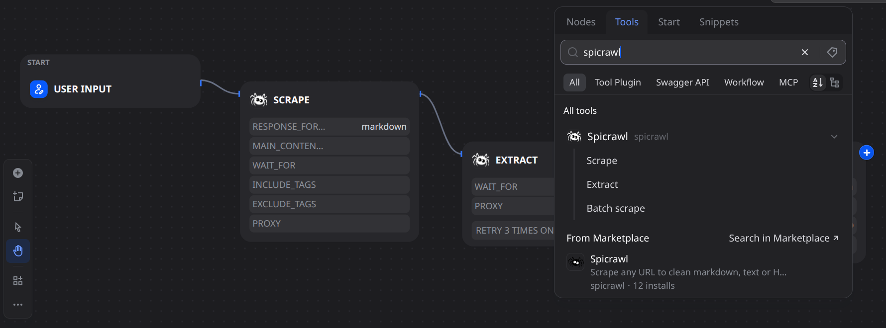
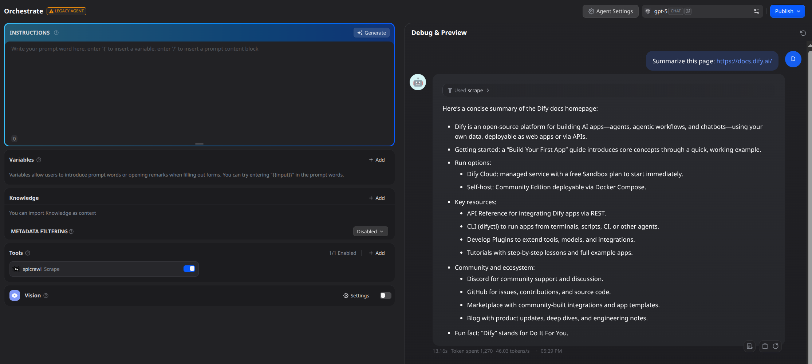

## Overview

To scrape a website in Dify, install the Spicrawl plugin, add a free Spicrawl API key, and use the **Scrape Web Page** tool: enter a URL and it returns the page as clean Markdown (or plain text or HTML) that LLMs, RAG pipelines and AI agents can read, including pages that need JavaScript to load.

[Spicrawl](https://spicrawl.com) is a web scraping API. This plugin brings it into Dify workflows, chatflows and agents so you can scrape website content, extract structured data as JSON, and batch scrape a list of URLs in one run. Convert any URL into clean, structured data for a knowledge base, a RAG pipeline, or automated web data extraction and analysis.

- **Website to Markdown.** The main content of a page, without navigation, footers and sidebars, so it costs fewer tokens. Plain text and raw HTML are also available.
- **JavaScript rendering.** Turn it on, or wait for a CSS selector such as `.price`, when a normal scrape returns an empty or "loading" page.
- **Structured data extraction.** Map field names to CSS selectors and get JSON back, or read the page's own JSON-LD and OpenGraph metadata with no selectors.
- **Batch scraping.** Up to 100 URLs in one run.
- **Your own proxy** (`http`, `https`, `socks5` or `socks5h`) when a site needs one.

## Configuration

1. Install **Spicrawl Web Scraper** from the Dify Marketplace. You can also install the `.difypkg` file from a [`dify-v*` release](https://github.com/OfficialSpicrawl/agent-plugins/releases).
2. Apply for an API key at https://app.spicrawl.com/dashboard/keys. The free plan includes 1,000 credits a month and needs no credit card. Keys look like `spicrawl_live_...` (spends credits) or `spicrawl_test_...` (cannot spend live credits). Give the key the `scrape` scope, plus `batch` if you will use Batch Scrape URLs. New keys have both by default.
3. In Dify, go to **Plugins > Spicrawl > To Authorize** and paste the key. Dify checks it with a free call that spends no credits.



The Dify plugin runtime must be able to reach `https://api.spicrawl.com` over HTTPS (port 443). Nothing else is needed.

## Tool Features

### Scrape Web Page

Convert any URL into clean Markdown, plain text or HTML that an LLM can read, including JavaScript-built pages.

Inputs: URL, JavaScript rendering, Output format, Main content only, Wait for selector, Include / Exclude selectors, Proxy URL. The `text` output is the page content; the `json` output holds `target_status` (the site's HTTP status), `credits`, `cache`, `request_id` and any `warning`.



### Extract Page Data

Pull named fields from one page as JSON, ready for a database, a spreadsheet or the next node in your workflow.

Inputs: URL, Fields (JSON) such as `{"title": "h1", "price": ".price", "next": "a.next@href"}`, Autoparse, JavaScript rendering. Append `@attribute` to a selector to read an attribute, and use a rule such as `{"selector": ".tag", "kind": "list"}` to return every match. Output `text` is the data; `json` adds `empty_fields`, the selectors that matched nothing (the first sign a site changed its markup).



### Batch Scrape URLs

Scrape up to 100 URLs as one job and get every page back in a single run, for example to fill a knowledge base.

Inputs: URLs (one per line) or Job ID, Output format, JavaScript rendering, Max wait (5 to 240 seconds). If the job is still running when the wait ends, the tool returns a Job ID; run it again with that Job ID to collect the results (kept for 72 hours). Batch items do not support extraction; use Extract Page Data per URL.



## Usage

### Chatflow / Workflow Apps

1. Add a **Spicrawl** tool node to your chatflow or workflow.
2. Pick a tool: Scrape Web Page, Extract Page Data or Batch Scrape URLs.
3. Define the inputs: a URL (typed in or taken from an earlier node) and any options, such as JavaScript rendering.
4. Run it. Pass the `text` output to an LLM node, or to whichever step in your workflow indexes content for your knowledge base.



### Agent Apps

1. Add the Spicrawl tools to your agent.
2. Paste a URL in the chat and ask a question about it.
3. The agent calls the tool, so the LLM has the latest online data from that page to answer with. If a page comes back empty, the tool descriptions tell the agent to retry with JavaScript rendering on its own.



## FAQ

**Does it work on JavaScript-heavy sites?** Yes. Turn on **JavaScript rendering** (or set **Wait for selector**) and the page's scripts run before the content is captured. Use it when a normal scrape comes back empty or shows a loading placeholder.

**Can I use it for RAG and knowledge bases?** Yes. The default output is clean Markdown with navigation, footers and sidebars removed, which suits feeding a model or a RAG index. Pass the `text` output to an LLM node or to whatever step in your workflow indexes content.

**What does it cost?** Spicrawl's free plan includes 1,000 credits a month, no credit card needed. A plain page costs 1 credit and a JavaScript-rendered page costs 3. Failed requests, bot-challenge pages and pages where the site answers with an error status such as 403 or 500 cost nothing. Markdown conversion, selectors and extraction add nothing. See https://docs.spicrawl.com/credits.

**Can I extract specific fields from a page?** Yes. Use **Extract Page Data** with a JSON object that maps field names to CSS selectors, for example `{"title": "h1", "price": ".price"}`, or turn on Autoparse to read the page's own structured metadata. You get JSON back.

**Can it crawl a whole website?** No. It scrapes the URLs you give it and does not follow links by itself, so it is not a web crawler. To cover many pages, pass a list of up to 100 URLs to **Batch Scrape URLs**.

## Errors and security

- Failures show the Spicrawl error code, its detail and a hint, for example `ERR::AUTH::INSUFFICIENT_SCOPE` when the key lacks the `batch` scope. Full list: https://docs.spicrawl.com/errors.
- The plugin only calls the fixed HTTPS endpoint `https://api.spicrawl.com`. It runs no code, commands or SQL and uses no filesystem or Dify storage.
- It fetches URLs you or your agent supply, through Spicrawl, which refuses private and reserved addresses. Constrain the URL input in workflows that take it from untrusted users.
- Requests have timeouts and the API key never appears in errors or output. The optional Proxy URL may contain credentials, so treat the node configuration that holds it like any other secret.

## Links

- Source: https://github.com/OfficialSpicrawl/agent-plugins/tree/main/dify (in the [agent-plugins](https://github.com/OfficialSpicrawl/agent-plugins) repository)
- Spicrawl API docs: https://docs.spicrawl.com
- Get an API key: https://app.spicrawl.com/dashboard/keys
- Contact: support@spicrawl.com
- Privacy: see [PRIVACY.md](PRIVACY.md)

## Development

```bash
pip install -r requirements.txt pytest
python -m pytest tests          # offline: runs against a local fake API
dify plugin package .           # builds spicrawl.difypkg
```
